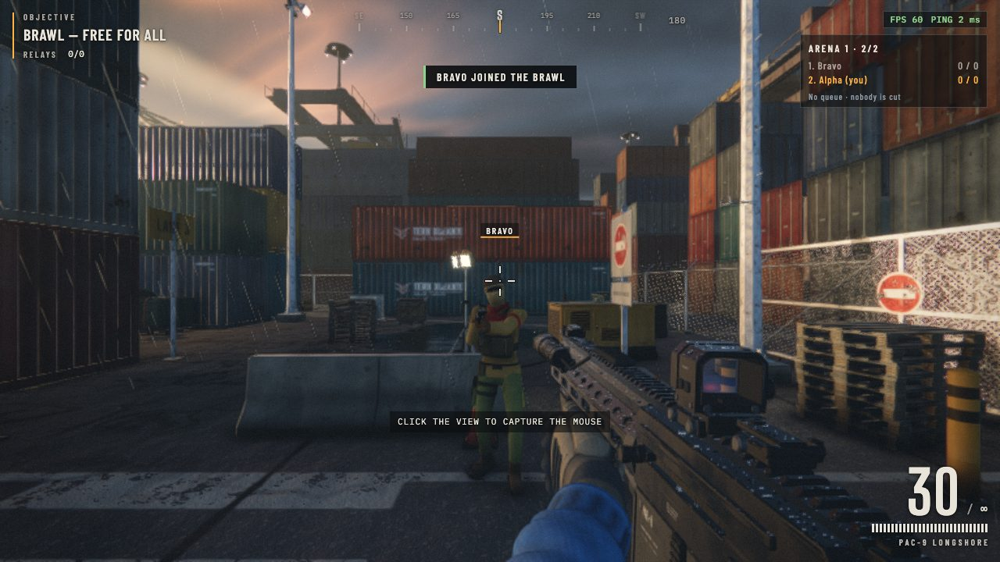
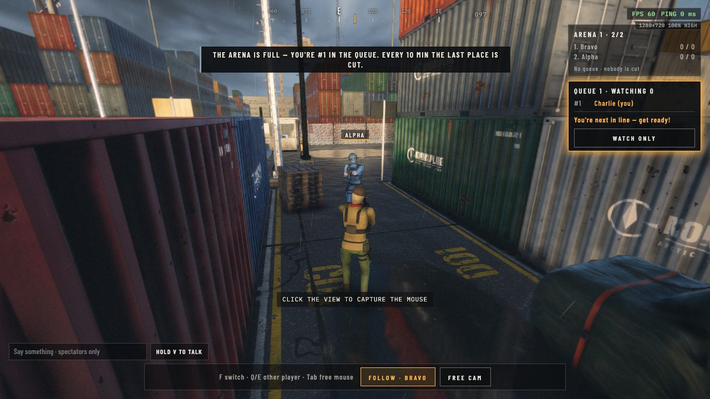

# Saltline Arena

**English** · [中文](README.zh-CN.md)

**A free multiplayer browser FPS: a harbour free-for-all you can play on a phone or a computer — no download, no sign-up.**

## Play online

**[https://saltline.kakoola.com/](https://saltline.kakoola.com/)** — press **Play** to join the brawl.

- Up to 6 players fight in one arena. When it is full you queue and spectate; every so often the last place is cut to make room for the queue.
- Phone: open it in Safari / Chrome and **Add to Home Screen** to play full-screen (the game shows a step-by-step guide); on Android and iPad, pressing **Play** also goes fullscreen by itself. Computer: WASD + mouse.
- No account and no name needed: first-time players get a random callsign (Viper, Falcon, Nimbus …) they can change.
- Two characters (SWAT Operator / Masked Raider). Spectators can text-chat and hold-to-talk, and replay the last 20 voice messages.
- Built for mobile networks: positions travel over a UDP (WebRTC) data channel with an automatic WebSocket fallback, so a lost packet never freezes the game for seconds the way TCP does.
- Want the original single-player mission, or a 1v1 with a friend? **More modes** on the main menu has Mission and 1v1 Duel.





## Origin and relationship to the original project

Saltline was created and published by **[Felix Rieseberg](https://x.com/felixrieseberg/status/2119925633564463609)** as a single-player FPS inside a Claude Artifact. **[realskyrin/fps3ademo-saltline](https://github.com/realskyrin/fps3ademo-saltline)** restored that artifact into a runnable, analysable local project. Saltline Arena is an independent **multiplayer fork** built on top of that work:

- **From the original**: the single-player mission, the harbour level, weapons, audio, visuals and menu style, and the modular code layout. The game first appeared as a [Claude Artifact](https://claude.ai/artifact/BGY1SztrAYcJQHSsnHHGmp).
- **New here**: a game server (`server/`), 1v1 duels, a 6-player brawl (queue, spectating, chat, push-to-talk), DuoWorld World Package support and avatars (SWAT Operator, Masked Raider, with held-gun, reload and inspect animations synced to other players), climbing, touch controls and Home Screen full-screen support, adaptive quality and a 30 fps fallback.
- **Different goal**: the original project is for restoring and analysing Saltline's code; this one extends the gameplay and puts it online for people to play. It is not a mirror and does not send changes back upstream.

> Licence note: the original repository ships no LICENSE file. Code and assets that come from it belong to their original authors. Licences for Three.js and the fonts are in `licenses/`. For the licence of the new parts see `LICENSE` (if it is not there yet, ask the maintainer before reusing).

## Host your own server

`deploy/` contains a systemd unit (`saltline-arena.service`), an nginx config (`nginx-saltline.conf`: static site + `/ws` reverse proxy to the game server) and `deploy.sh` (build and sync to a server). The game server needs only Node. When the page is served over HTTPS on the default port it connects to `wss://<your domain>/ws` automatically.

**Optional UDP (WebRTC) for poses.** Set `RTC_PORT` (one UDP port, e.g. `40000`) and, behind NAT (any cloud VM), `RTC_PUBLIC_IP` (the address players reach you at) in the service unit, open that UDP port in the firewall / security group, and install the optional native module (`deploy.sh` runs `npm install --omit=dev` on the host for it). Without them, or if the module will not load, the server runs WebSocket-only. The module is pinned to `node-datachannel@0.20.0` because newer prebuilt binaries need a newer glibc than CentOS 8 has. See "Networking" below.

## Local development

Node.js 20.19+ or 22.12+, and a WebGL 2 browser (Chrome/Edge recommended).

```sh
git clone https://github.com/zhourenjian/saltline-arena.git
cd saltline-arena
npm ci
npm run dev
```

Open <http://127.0.0.1:5173/>. Press **Play** to join the brawl (start the server first with `npm run server`), or pick Mission under **More modes** for the single-player game. The game, Three.js and all fonts are local: no Claude, Google Fonts, other online service or API key is needed at run time.

## Build and preview

```sh
npm run check
npm run build
npm run preview
```

`npm run build` writes `dist/standalone/` (the web build, relative paths only, can be hosted under any sub-path over HTTP) and `dist/world-package/` (a DuoWorld World Package; its documentation lives in the local, unpublished `duoworld/` folder).

## Main menu, characters, 1v1 and brawl

The main menu has one big **Play** (the brawl), then **Character**, **Settings**, **Controls**; **More modes** hides **Mission** and **1v1 Duel**.

- **Character**: choose between the two installed avatars, with a live preview. **SWAT Operator** (mid-blue fatigues, helmet, goggles, vest) and **Masked Raider** (khaki jacket, olive trousers, sand-coloured mask, red scarf) — both masked, both bright so they are easy to tell apart. Avatars carry no gun; in game they hold the same PAC-9 you see in first person. The choice is saved in `localStorage` (`saltline.character.v1`); `?avatar=` wins over it. With no choice you wear the SWAT Operator.
- **Climbing**: hold **W** and press **Space** at a crate or low wall. From the ground you can vault edges 0.62–1.65 m high, in the air you can grab edges up to 2.25 m. You cannot fire while climbing. Reloads and inspections are visible to other players, and an opponent's muzzle flash and tracers come from the gun in their hands.
- **1v1 duel**: start the server, one player creates a room and the other enters its 4-digit code. Harbour map, no AI, first to 5 kills wins, respawn 3 s after dying.

```sh
npm run server                 # listens on 0.0.0.0:8787
PORT=9000 npm run server       # another port
ALLOWED_ORIGINS=https://example.com npm run server   # only accept these pages
```

On a LAN enter `ws://<server IP>:8787` in the duel menu. HTTPS pages need `wss://`, i.e. the server behind a TLS reverse proxy; `?server=wss://duel.example.com` prefills the address.

The server decides health, damage, kills, scores and spawns, but hits are reported by the client. It only checks rate and distance and **does not prevent cheating** — fine for friends, not for competitive play.

- **Damage**: 20 for a body shot, 50 for a headshot (100 health: 2 headshots or 5 body shots). In the single-player mission weak points do ×2.2.
- **Name tags**: shown only with a clear line from the camera to the head, fading with distance, so they never reveal someone behind a container.
- **Corner readout**: FPS, and the round-trip ping to the server (green / yellow / red) when connected.
- **Pause**: Esc / P pauses the world and fades the music out; it comes back when you resume.

### Brawl

Everyone connects to the same server. One arena holds up to 6 players (configurable).

- **Joining**: the brawl screen has **Join the brawl** and **Watch only**. With a free seat you play at once (alone you can walk around and wait); when full you queue and watch. Watch only does not queue; press J or the button later to queue.
- **Joins / leaves**: everyone in the arena sees a notice at the top centre.
- **When full**: every 60 s the player with the worst record (fewest kills, most deaths) is cut — 2 players if 6 or more are queued. Players in for under 45 s are safe; 10 deaths in one stay also ends it. Cut players rejoin the end of the queue. When a seat opens, the next in queue has 15 s to accept (J or button) before it goes to the next.
- **Anti-camping**: with a queue, players idle for 45 s or without network data for 12 s are removed.
- **Many players**: when all arenas are full and 4+ are queued a new arena opens (up to 3).
- **Spectating**: Q / E switch the followed player, F toggles free cam (WASD to fly, Space / C up and down; local only), [ / ] switch arena. **Tab** frees the mouse (no pause) for the chat scrollbar and 👎; click the view or press Tab again to return. On a phone use the Follow / Free cam button (tap Follow again for the next player).
- **Waiting list**: spectators see up to 10 names under the scoreboard — queued players first, numbered; watch-only players after, marked 👁. The last line is your own status and flashes when you are next or your seat is ready.
- **Text chat**: Enter to open. Spectators can 👎 a message (once each); every 👎 mutes its author for 10 s × the number of 👎. Max 6 messages per minute. Callsigns are 3–8 characters with at least one letter or digit.
- **Voice**: hold V or the 🎤 button. At most 2 others may be talking; you get 10 s with a 5 s countdown, 3 turns per minute. While you talk the button shows a level meter and how many spectators are listening. Browsers need one click or key press before audio can play (entering the brawl counts). The last 20 voice messages are kept in the browser; the **▶** button in the chat plays one again (also the ones that could not play because audio was still locked). The game music turns down while a message plays. Audio and microphone stop when the page goes to the background. If the default microphone only delivers silence (a laptop with the lid closed, say) the game tries the other inputs; in Chrome you can also pick the input from the microphone icon in the address bar. **Speakers must use `https://` or a local address**: browsers give no microphone on `http://<LAN IP>`; you can still listen.
- **Chat and voice are spectators-only** so nobody can call out positions to the players. Players can use **Leave seat · watch** in the pause menu.
- **Microphone**: asked for and recorded only while you hold the talk key; audio is relayed through the server and never stored.

```sh
BRAWL_MAX_PLAYERS=4 BRAWL_CULL_SECONDS=120 BRAWL_CULL_COUNT=2 npm run server
```

Settings (defaults): `BRAWL_MAX_PLAYERS` (6, 2–12), `BRAWL_CULL_SECONDS` (60, 30–600), `BRAWL_CULL_COUNT` (1), `BRAWL_CULL_COUNT_BUSY` (2), `BRAWL_BUSY_QUEUE` (6), `BRAWL_DEATH_LIMIT` (10), `BRAWL_MAX_ARENAS` (3), `BRAWL_OPEN_ARENA_QUEUE` (4), `BRAWL_OFFER_SECONDS` (15), `BRAWL_AFK_SECONDS` (45), `BRAWL_STALLED_SECONDS` (12), `BRAWL_MAX_QUEUE` (200), `BRAWL_MAX_SPECTATORS` (500), `MAX_CONNECTIONS` (1000), `MAX_CONNECTIONS_PER_IP` (4), `TRUST_PROXY=1` (take the address from `X-Forwarded-For` behind a proxy), `RTC_PORT` (UDP port for the WebRTC data channel; unset = WebSocket only), `RTC_PUBLIC_IP` (the public address to advertise, needed behind NAT). `GET /health` returns the online count.

### Networking

Everything is JSON over one WebSocket (TCP). On a mobile network TCP can stall for seconds after a lost packet, and everything queued behind it arrives late. So when the browser supports WebRTC the page also opens an **unordered, no-retransmit data channel** (UDP) to the server, signalled over the WebSocket, and the frequent, replaceable messages use it: player poses, spectator snapshots and a UDP ping. Chat, voice, shots, damage, kills, seats and queues stay on the WebSocket because they must arrive. If WebRTC is unavailable or fails the game keeps working over the WebSocket (`?rtc=0` turns UDP off for comparison).

The server also relays only the newest pose of a burst (after a stall on the player's own link) and drops poses for a client whose send buffer is backed up, so a recovering link gets the current state instead of a replay.

Measuring: each client keeps its recent ping samples (split into network time and time waiting behind its own main thread) and reports a summary every 30 s; the server logs one `net …` line per report (`udp=… uavg=… uloss=… avg=… p95=… max=…`). `?vpdebug=1` shows the same numbers on screen, with the current transport (`net udp` / `net ws`). On a 4G test phone the UDP ping stayed around 35 ms while the WebSocket ping spiked to 250–570 ms in the same windows.

Mutes are recorded per "IP address + nickname": others on the same network are unaffected and reconnecting does not lift them, but reconnecting under another nickname does.

## Project layout

| Path | Contents |
| --- | --- |
| `index.html` | page entry, canvas, boot screen |
| `src/game.js` | start-up: creates the world and the runtime bridge |
| `src/duoworld/` | World/avatar adapter layer (WorldAdapter, AvatarHost, RuntimeBridge, World Package entry) |
| `public/avatars/` | avatar packages (SWAT Operator, Masked Raider) |
| `src/app/` | system wiring, main loop, boot screen, diagnostics, viewport |
| `src/vendor/three-r180.js` | vendored Three.js r180 |
| `src/core/`, `src/render/`, `src/world/` | config, events, maths; renderer, sky, shadows, post; collision, props, level |
| `src/input/`, `src/player/`, `src/combat/` | input, player, combat |
| `src/weapons/`, `src/enemies/`, `src/audio/`, `src/effects/` | weapons, enemies, sound, particles |
| `src/ui/`, `src/game/`, `src/ui.css` | HUD, menus, settings, mission flow, styles |
| `src/versus/`, `src/brawl/`, `server/` | 1v1 and brawl clients, the WebSocket server (zero dependencies; WebRTC in `server/rtc.mjs` and `src/versus/rtc.js` is optional) |
| `deploy/` | systemd unit, nginx config, deploy script |
| `tests/` | automated tests for duel, brawl, WebRTC (also in a real browser), ladders, mobile layout |
| `scripts/screenshots.mjs` | regenerates the README screenshots |
| `archive/` | the original single file and its provenance (size, SHA-256) |
| `docs/` | development notes and validation records (Chinese) |
| `licenses/` | Three.js and font licences |

## Controls

| Action | Keys |
| --- | --- |
| Move / look | WASD / mouse |
| Fire / aim | left / right mouse button |
| Reload / melee | R / F |
| Jump / sprint | Space / Shift |
| Climb | hold W + Space at a low wall or crate |
| Ladders | E at the ladder (or W + Space) to grab, W / S to move, Space to jump off |
| Crouch | C or Ctrl |
| Cut a relay | hold E near it |
| Pause | Esc or P |
| Brawl: accept seat / switch player / free cam / chat / talk / switch arena / free mouse | J / Q E / F / Enter / hold V / [ ] / Tab |
| First / third person (with an avatar) | T |

Settings live in the browser's `localStorage`: `saltline.settings.v1`, `saltline.character.v1`, `saltline.versus.v1`.

## Phones and tablets

A browser tab loses space to its address bar and toolbar. In Safari (iOS) use Share ▸ Add to Home Screen, or in Chrome (Android) menu ▸ Install app, then open it from the icon for full screen; the title page shows the steps for your platform. On Android (Chrome) and iPad, pressing **Play** goes fullscreen when the browser allows it; iPhone Safari has no fullscreen API for pages, so use Add to Home Screen there. Some Android launchers (Samsung, for example) keep a grey status bar on Home Screen apps whatever the manifest says; the in-browser fullscreen after pressing Play has no status bar. In the brawl the MENU button at the top right opens the pause menu. The brawl has unlimited ammo. Debug overlay for layout and network problems: add `?vpdebug=1` to the address.
