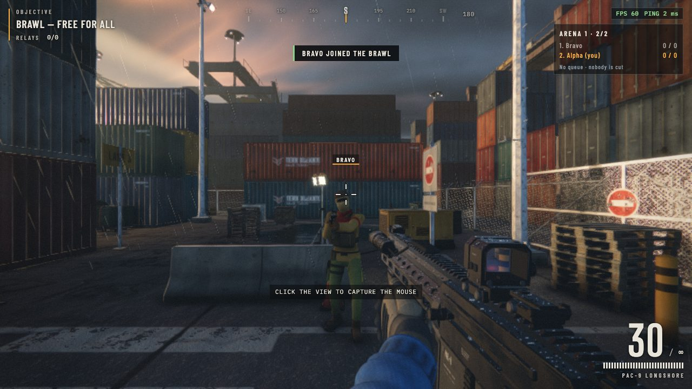
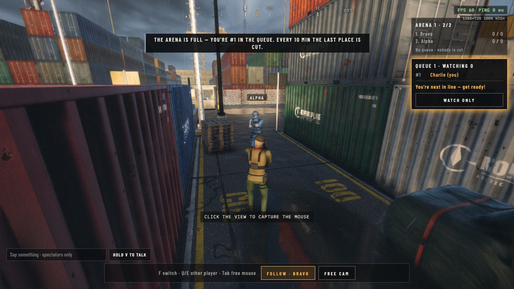

# Saltline Arena

[English](README.md) · **中文**

**免费的浏览器多人 FPS：港口里的自由混战，手机和电脑都能玩，不用下载、不用注册。**

## 在线试玩

**[https://saltline.kakoola.com/](https://saltline.kakoola.com/)** — 点 **Play** 进入大乱斗。

- 一局最多 6 人同场混战，满了就自动排队并旁观；每隔一段时间淘汰最后一名，让位给排队的人。
- 手机：用 Safari / Chrome 打开，**添加到主屏幕**可以全屏玩（游戏里有图文教程）；Android 和 iPad 上点 **Play** 也会自动进入全屏。电脑：WASD + 鼠标。
- 不用注册，也不用先想名字：第一次进入会随机分配一个代号（Viper、Falcon、Nimbus……），可以自己改。
- 两个角色可选（SWAT Operator / Masked Raider），旁观者可以文字聊天、按住说话（对讲），还能重听最近 20 条语音。
- 针对手机网络优化：位置数据走 UDP（WebRTC 数据通道），不通时自动回退 WebSocket，丢一个包不会像 TCP 那样让游戏卡住好几秒。
- 想单人玩原版任务，或者找朋友 1v1：主菜单 **More modes** 里有 Mission 和 1v1 Duel。

## 来源和关系

Saltline 最初由 **[Felix Rieseberg](https://x.com/felixrieseberg/status/2119925633564463609)** 创作并发布（Claude Artifact 里的单机 FPS）。Saltline Arena 是在 **[realskyrin/fps3ademo-saltline](https://github.com/realskyrin/fps3ademo-saltline)**（原项目，一个把 Claude Artifact 里的 Saltline 单机游戏恢复成可运行、可分析的本地项目）的基础上，独立发展出来的**多人联机版本**：

- **来自原项目**：Saltline 的单人任务、港口关卡、武器、音效、画面和菜单风格，以及模块化后的代码结构。原游戏的作者是 [Felix Rieseberg](https://x.com/felixrieseberg/status/2119925633564463609)，最早发布为 [Claude Artifact](https://claude.ai/artifact/BGY1SztrAYcJQHSsnHHGmp)。
- **本项目新增**：联机服务器（`server/`）、1v1 对战、6 人大乱斗（排队、旁观、聊天、对讲）、DuoWorld World Package 适配和 Avatar（SWAT Operator、Masked Raider，持枪动作和换弹同步）、攀爬、手机触控与 Home Screen 全屏支持、自适应画质与 30 fps 兜底。
- **目的不同**：原项目的目的是还原并分析 Saltline 的代码结构；本项目是以扩展玩法、让更多人在线玩为目的的独立项目，不是原仓库的镜像，也不会向原仓库提交。

> 许可说明：原项目仓库没有附带 LICENSE 文件。本项目里来自原项目的部分，版权归原作者；仓库里 Three.js 和字体的许可文本在 `licenses/`。本项目新增部分的许可证见 `LICENSE`（如果还没有，请先询问维护者再复用）。

## 自己部署一个服务器

`deploy/` 里有现成的 systemd 单元（`saltline-arena.service`）、nginx 配置（`nginx-saltline.conf`：静态站点 + `/ws` 反向代理到游戏服务器）和 `deploy.sh`（构建并同步到服务器）。游戏服务器只有 Node，没有额外依赖。页面在 HTTPS 站点默认端口上时，会自动连同域名下的 `wss://<域名>/ws`。

**可选：位置数据走 UDP（WebRTC）。** 在服务单元里设置 `RTC_PORT`（一个 UDP 端口，例如 `40000`），在 NAT 后面（所有云主机）还要设置 `RTC_PUBLIC_IP`（玩家访问你的公网地址），并在防火墙 / 安全组里放开这个 UDP 端口，同时安装可选的原生模块（`deploy.sh` 会在服务器上执行 `npm install --omit=dev`）。没有这些配置、或者模块加载失败，服务器就只用 WebSocket。模块固定为 `node-datachannel@0.20.0`，因为更新版本的预编译二进制需要比 CentOS 8 更新的 glibc。详见下面的“网络”一节。

## 游戏截图





## 本地开发

需要 Node.js 20.19+ 或 22.12+。推荐使用当前 LTS 和 Chrome/Edge 等支持 WebGL 2 的浏览器。

```sh
git clone https://github.com/zhourenjian/saltline-arena.git
cd saltline-arena
npm ci
npm run dev
```

打开 <http://127.0.0.1:5173/>，点击 **Play** 进入大乱斗（本地需要先 `npm run server`），或在 **More modes** 里选 Mission 单人。修改脚本或样式后浏览器会重新加载，当前局会重置。

依赖已经安装时，直接执行 `npm run dev`。游戏、Three.js 和全部字体均在本地，运行期间不需要 Claude、Google Fonts 或其他在线服务，也不需要 API Key。

## 构建和预览

```sh
npm run check
npm run build
npm run preview
```

`npm run build` 生成两份产物：

- `dist/standalone/`：独立网页版，预览地址 <http://127.0.0.1:4173/>。只使用相对路径，可以放到任意静态 HTTP 服务的任意子路径下；应通过 HTTP 打开，以便脚本模块和浏览器输入正常工作。
- `dist/world-package/`：DuoWorld World Package（`world.json` + `world.js` + `assets/`），供 DuoWorld 宿主加载（相关文档在本地的 `duoworld/` 目录，不随仓库发布）。

## 主菜单、角色选择、1v1 对战和大乱斗

主菜单是一个大的 **Play**（进入大乱斗），下面是 **Character**、**Settings**、**Controls**；**More modes** 里藏着 **Mission**（原版单人任务）和 **1v1 Duel**。

- **角色选择（CHARACTER）**：在已安装的 Avatar 包之间选择，右侧实时预览，两个警匪风格角色（都戴头套、不露脸）：**SWAT Operator**（中蓝色作战服、头盔、护目镜、防弹背心）和 **Masked Raider**（卡其色夹克、橄榄绿长裤、沙色头套、红围巾），两套都是亮色，在场景里容易分辨。角色本身不带枪，预览时空手；进入游戏后手里拿的就是第一人称那支 PAC-9。选择会保存在 `localStorage`（`saltline.character.v1`）。URL 的 `?avatar=` 和宿主指定的 Avatar 优先于保存的选择。列表由 `index.html` 里的 `window.SaltlineCharacters` 控制：现在只列出这两个；没有选择时默认穿 SWAT Operator。
- **攀爬**：在箱子或矮墙前按住 **W** 再按 **Space** 翻上去。站在地上能翻 0.62–1.65 m 高的边沿，跳起后在空中能抓住 2.25 m 以内的边沿，更高的墙不能攀爬。攀爬时不能开火。翻越时第三人称身体有具体动作：双手抓住边沿、膝盖蹬上、枪背到身后；爬梯子是交替抓握。换弹和检视（闲置时把枪侧过来看）会同步给其他玩家：别人能看到你卸弹匣、插弹匣、拉机柄。对手的火光和曳光从对方手里那支枪的枪口喷出，第一人称手臂的袖子和手套颜色会按所穿角色换色。
- **1v1 对战**：先启动自带的对战服务器，然后一人创建房间，另一人输入 4 位房间码加入。港口地图，没有 AI，先拿到 5 杀的一方获胜，阵亡 3 秒后在远处重生。

```sh
npm run server                 # 默认监听 0.0.0.0:8787
PORT=9000 npm run server       # 换端口
ALLOWED_ORIGINS=https://example.com npm run server   # 只接受这些页面的连接
```

两台电脑在同一局域网时，在对战菜单里填 `ws://<服务器电脑的 IP>:8787`。HTTPS 页面里浏览器要求使用 `wss://`：需要把服务器部署在带 TLS 的反向代理后面。也可以用 `?server=wss://duel.example.com` 预填地址。

对战服务器决定血量、伤害、击杀、比分和出生点，但命中由客户端上报。服务器只做频率和距离检查，**不防作弊**，只适合和朋友对战。

- **伤害**：1v1 和大乱斗中打身体 20、打头 50（满血 100：爆头 2 枪、身体 5 枪）。单人任务里敌人的弱点伤害 ×2.2。
- **名牌**：对手头顶的名字只在镜头到头部之间没有遮挡时显示，并随距离淡出，不会透过集装箱或墙暴露位置。
- **角落读数**：右上角显示 FPS；连上对战服务器时同时显示延时（PING，往返毫秒，绿 / 黄 / 红）。
- **暂停**：Esc / P 暂停游戏世界，背景音乐淡出；继续后恢复。

### 大乱斗（BRAWL）

所有人连到同一个服务器排队。一个场地最多 6 人（可配置）。

- **进入**：大乱斗页面有 **Join the brawl** 和 **Watch only** 两个按钮。Join 不再弹「加入 / 观战」框：有空位直接上场（只有 1 个人时也可以在场地里自由走动，等别人来），满员直接排队观战。Watch only 只观战不排队，之后可以按 J 或底栏按钮排队。
- **有人加入 / 离开**：场地里所有人在屏幕中上方看到提示。
- **满员**：排队并观战。每 60 秒按战绩（击杀多、阵亡少）淘汰最后 1 名（排队 ≥ 6 人时淘汰 2 名），刚进场不满 45 秒的人不会被淘汰；一次上场阵亡 10 次也会下场。被淘汰的人自动重新排到队尾。轮到排队的人时有 15 秒确认（J 或点按钮），超时让给下一位。
- **防卡位**：有人排队时，45 秒不动或 12 秒没有网络数据的玩家会被请下场。
- **人多时**：所有场地都满且排队 ≥ 4 人时开新场地（最多 3 个）。
- **观战**：Q / E 切换跟随的玩家，F 切换上帝视角（WASD 自由飞行，Space / C 升降；只在自己的客户端移动），[ / ] 切换场地。按 **Tab** 释放鼠标（不暂停），可以拖聊天滚动条、点 👎；点一下画面或再按 Tab 回到视角控制。
- **等待名单**：观众在右上角（记分板下面）看到最多 10 个名字。排队的人在前，带号码；只观战的人在后，显示 👁、不显示号码，最新进来的排前面。最后一行是自己的情况：「You are #N of Q in the queue」或「Not in the queue · watching only」。排到第 1 名或座位已经留给自己时，这一行会闪烁提醒。
- **文字聊天**：Enter 打开。每条消息可以被其他观众点 👎，每人对每条只算一次；每个 👎 让作者 10 s × 👎 数之内不能发言。每分钟最多 6 条。
- **语音**：按住 V 或 🎤 按钮抢麦。同时说话的其他人不超过 2 个时可以说 10 秒，最后 5 秒倒计时；每分钟最多抢 3 次。说话时按钮上有电平条和正在收听的人数；最近 20 条语音保存在浏览器里，聊天里的 **▶** 按钮可以重听（包括因为音频还没解锁而没能自动播放的）；播放语音时游戏音乐会自动调小；页面进入后台时声音和麦克风会停止。默认麦克风只有静音时（比如合上盖子的笔记本），游戏会自动尝试其他输入，Chrome 里也可以在地址栏的麦克风图标里选择输入设备。语音自动播放：浏览器要求页面先有一次点击或按键才允许出声，进入大乱斗的那次点击就会解锁；如果还没解锁，会提示「点击或按任意键收听」。**说话的一方必须用 `https://` 或本机地址（`localhost` / `127.0.0.1`）打开页面**：浏览器在 `http://<局域网 IP>` 页面上不提供麦克风，这时会提示原因，但仍能听到别人。
- **聊天和语音只在观众之间**，场上玩家收不到，避免观众给场上的人报点。场上玩家可以在暂停菜单选 **Leave seat · watch** 下场观战。
- **麦克风**：只在按下抢麦时请求权限并录音，松开即关闭；音频只经服务器转发，不保存。

```sh
BRAWL_MAX_PLAYERS=4 BRAWL_CULL_SECONDS=120 BRAWL_CULL_COUNT=2 npm run server
```

可配置项（默认值）：`BRAWL_MAX_PLAYERS`（6，2–12）、`BRAWL_CULL_SECONDS`（60，30–600）、`BRAWL_CULL_COUNT`（1）、`BRAWL_CULL_COUNT_BUSY`（2）、`BRAWL_BUSY_QUEUE`（6）、`BRAWL_DEATH_LIMIT`（10）、`BRAWL_MAX_ARENAS`（3）、`BRAWL_OPEN_ARENA_QUEUE`（4）、`BRAWL_OFFER_SECONDS`（15）、`BRAWL_AFK_SECONDS`（45）、`BRAWL_STALLED_SECONDS`（12）、`BRAWL_MAX_QUEUE`（200）、`BRAWL_MAX_SPECTATORS`（500）、`MAX_CONNECTIONS`（1000）、`MAX_CONNECTIONS_PER_IP`（4）、`TRUST_PROXY=1`（在反向代理后面时从 `X-Forwarded-For` 取地址）、`RTC_PORT`（WebRTC 数据通道的 UDP 端口，不设置就只用 WebSocket）、`RTC_PUBLIC_IP`（对外公布的公网地址，NAT 后面必需）。`GET /health` 返回在线人数。

### 网络

全部消息是同一条 WebSocket（TCP）上的 JSON。手机网络下 TCP 丢一个包可能卡住好几秒，后面排队的数据全部延迟。所以浏览器支持 WebRTC 时，页面会额外打开一条**无序、不重传的数据通道**（UDP）到服务器（信令走 WebSocket），频繁且可被后一条替代的消息走这条通道：玩家位置、旁观者快照和 UDP ping。聊天、语音、开火、伤害、击杀、座位和排队必须送达，仍走 WebSocket。WebRTC 不可用或失败时游戏照常走 WebSocket（地址加 `?rtc=0` 可以关掉 UDP，用于对比）。

服务器还会在玩家自己的网络卡顿恢复后，只转发突发位置包里最新的一条；对发送缓冲已经积压的客户端直接丢弃过期的位置包，这样恢复后拿到的是当前状态，而不是一串旧状态的回放。

测量：每个客户端保留最近的 ping 样本（分成网络时间和等自己主线程的时间），每 30 秒向服务器上报摘要，服务器每次记一行 `net …` 日志（`udp=… uavg=… uloss=… avg=… p95=… max=…`）。地址加 `?vpdebug=1` 会在屏幕上显示同样的数字和当前通道（`net udp` / `net ws`）。在一台 4G 测试手机上，同一时间窗口里 UDP ping 稳定在约 35 ms，WebSocket ping 会冲到 250–570 ms。

禁言按「IP 地址 + 昵称」记录：同一网络下的其他人不受影响，断线重连也不会解除；但换昵称重连可以绕过。

## 继续修改

| 文件 | 内容 |
| --- | --- |
| `index.html` | 页面入口、画布、启动界面 |
| `src/game.js` | 启动入口：创建 World 和 RuntimeBridge |
| `src/duoworld/` | DuoWorld 协议层：WorldAdapter、AvatarHost、RuntimeBridge、World 对象、清单和 World Package 入口 |
| `public/avatars/` | Avatar Package（每个目录一个包） |
| `src/app/` | 系统装配、主循环、启动界面、诊断和基准模式 |
| `src/vendor/three-r180.js` | 独立保存的原版 Three.js r180，提供标准命名的导出 |
| `src/core/` | 世界/画质配置、事件、随机数、数学、通用几何和降级实现 |
| `src/render/` | 渲染器、天空、阴影、后处理、材质、纹理和着色器 |
| `src/world/` | 碰撞、道具注册与建模、关卡、远景、地面和水面 |
| `src/input/`、`src/player/`、`src/combat/` | 输入、玩家和战斗判定 |
| `src/weapons/`、`src/enemies/` | 武器/敌人的模型、动画和行为 |
| `src/audio/`、`src/effects/` | 声音合成、音库、混音、粒子和特效 |
| `src/ui/`、`src/game/` | HUD、菜单、设置和任务流程 |
| `src/ui.css` | 原版 HUD、菜单、移动端布局和动效 |
| `src/fonts.css`、`public/fonts/` | 原版三组字体的本地副本 |
| `vite.config.js` | 开发服务器、独立版构建和 source map 配置 |
| `vite.world.config.js`、`scripts/build-world-package.mjs` | World Package 构建 |
| `src/versus/`、`src/brawl/`、`server/` | 1v1 对战、大乱斗客户端和 WebSocket 服务器（零依赖；`server/rtc.mjs` 和 `src/versus/rtc.js` 里的 WebRTC 是可选的） |
| `tests/` | 对战、大乱斗、WebRTC（含真实浏览器）、梯子、手机适配的自动化测试 |
| `archive/original.html` | 与原站发布清单逐字节校验一致的原始单文件 |
| `archive/manifest.json` | 来源、发布版本、原始大小与 SHA-256 |
| `docs/DEVELOPMENT.md` | 游戏代码定位和诊断入口 |
| `docs/VALIDATION.md` | 本次恢复的验收结果 |
| `docs/REFACTOR_VALIDATION.md` | 模块拆分的代码、场景、截图与操作回归记录 |
| `licenses/` | Three.js 与字体的许可文本 |

**源码边界：**公开链接只提供一个已打包的 `index.html`，没有发布前的多文件源码、原始变量名或 source map。本地在恢复完整产物后，将它重新组织为 66 个 ES 模块，并为引擎导入、主要工厂函数和上下文参数补充了可读名称。复杂算法内部仍有原版压缩过的局部变量名。模块边界是本地重建的，构建生成的 source map 对应当前本地文件。

## 操作

| 动作 | 按键 |
| --- | --- |
| 移动 / 视角 | WASD / 鼠标 |
| 开火 / 瞄准 | 鼠标左键 / 右键 |
| 换弹 / 近战 | R / F |
| 跳跃 / 冲刺 | Space / Shift |
| 攀爬 | 在矮墙或箱子前按住 W + Space |
| 爬梯子 | 在梯子前按 E（或按住 W + Space）抓住，W / S 上下，Space 跳离；码头起重机腿旁的梯子通往楼梯塔、中层走道和吊臂走道 |
| 蹲下 | C 或 Ctrl |
| 切断中继 | 在中继附近按住 E |
| 暂停 | Esc 或 P |
| 大乱斗：接受上场 / 观战切人 / 上帝视角 / 聊天 / 抢麦 / 切场地 / 释放鼠标 | J / Q E / F / Enter / 按住 V / [ ] / Tab |
| 第一 / 第三人称（佩戴 Avatar 时） | T |

浏览器无法锁定鼠标时，原版也支持按住鼠标拖动视角，或方向键 / IJKL 转向、Enter 开火。触屏和手柄支持沿用原版，具体布局在 **CONTROLS** 中查看。

设置保存在当前浏览器的 `localStorage`：设置在 `saltline.settings.v1`，角色选择在 `saltline.character.v1`，对战服务器地址和昵称在 `saltline.versus.v1`。本地地址与原站的浏览器存储相互独立。

## 原件校验

恢复日期：2026-11-10；公开版本：`1794242702-61c7`。

```sh
npm run verify:archive
```

原件大小为 1,423,413 字节，SHA-256：

```text
f7081ef7b2fde5880e3c58184c720b2aa3b9115efe58ff71b48f6820d4f16f90
```

原件保留原始 Google Fonts 链接；本地开发入口使用已下载的字体。Claude 的页面外壳与注入运行时未加入本地游戏。

## 手机和平板

浏览器标签页里地址栏和工具栏会占掉屏幕，旋转时还可能错位。用 Safari（iOS）分享 ▸ 添加到主屏幕，或 Chrome（Android）菜单 ▸ 安装应用，再从主屏幕图标打开，就是全屏。游戏在标题页会给出分平台的步骤。Android（Chrome）和 iPad 上点 **Play** 会在浏览器允许时自动全屏；iPhone Safari 没有网页全屏接口，那里请用“添加到主屏幕”。部分 Android 桌面（例如三星）的主屏幕应用不管清单怎么写都会保留灰色状态栏，在浏览器里点 Play 后的全屏则没有状态栏。大乱斗里右上角的 MENU 按钮打开暂停菜单（调整设置、退出比赛）。大乱斗是无限弹药。排查布局或网络问题时，在地址后面加 `?vpdebug=1` 可以打开调试浮层。
